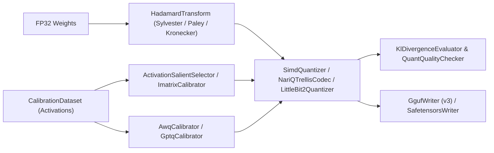

# Glacier.Quant Architecture

`Glacier.Quant` organizes quantization into standalone kernel primitives, second-order and activation-aware calibrators, quality evaluators, and streaming checkpoint serializers.

---

## Subsystem Pipeline

---

## Design & Kernel Details

### 1. Hadamard Transforms (`HadamardTransform`)

- **Sylvester FWHT:** Fuses the first `h = 1, 2, 4, 8` butterfly stages inside AVX-512F (`Vector512`) or AVX2 (`Vector256`) registers before iterating outer stages, then scales once by $1/\sqrt{\text{blockLen}}$.
- **Paley & Kronecker:** Precomputes padded Type-I Paley kernels for orders `12` (`stride 16`), `20` (`stride 32`), and `68` (`stride 80`) so dot products align to 16-float SIMD vectors without tail branches.

### 2. NariQ Circular Bitstream & SWAR Decoding (`NariQTrellisCodec`)

- Decodes `16x16` trellis tiles using the procedural multiplier `0x83DCD12Du` and a branch-free 32-bit SWAR horizontal byte sum (`(((xv >> 2) & 0x3F3F3F3Fu) * 0x01010101u) >> 24) - 126`) yielding exact integers in `[-126, +126]`.
- `TileMatVecAdd` fuses state decode directly with input activation dot products in AVX-512 / AVX2 registers.

### 3. LittleBit-2 Factorization & ADMM (`LittleBit2Quantizer`, `LittleBit2Svd`)

- Computes initial binary factors through SVD / Joint-ITQ orthogonal alignment and Dual-SVID tri-scale decomposition across parallel row tiles when element counts exceed `262,144`.
- `RefinePathAdmm` alternates coordinate-descent bit flips with closed-form continuous scale optimization under a strict monotonic Frobenius error guard.

### 4. Numerics in Calibration & Evaluation

- `AwqCalibrator` and `GptqCalibrator` accumulate activation norms and Hessians ($2 X^T X + \lambda I$) in `double` precision to preserve conditioning across thousands of calibration tokens, with up to `6` adaptive damping retries if Cholesky pivots dip below `1e-15`.
- `KlDivergenceEvaluator` computes log-probabilities with a `Log1p` formulation near the maximum logit so catastrophic cancellation never zeroes out divergence near `0`.
- `GgufWriter` aligns tensor sections cleanly to `DefaultAlignment = 32` and writes canonical `FP8_E4M3` ID `43u` while `GgufReader` / type tables retain legacy `104u` compatibility.
